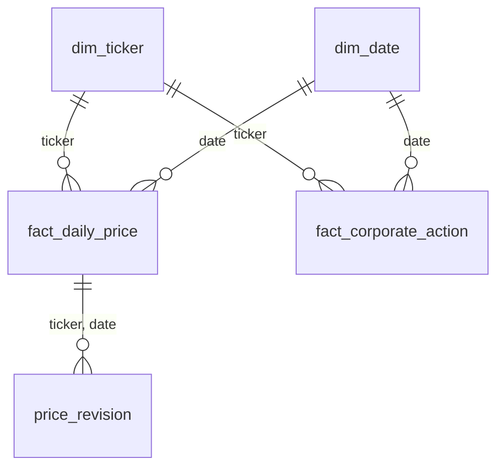

# MarketPulse

A lakehouse pipeline for daily S&P 500 market data, built on Databricks (Free Edition)
with PySpark and Delta Lake.

- **Sources:** Yahoo Finance via `yfinance` (daily OHLCV, adjusted close, dividends, splits,
  company profiles) and Wikipedia's S&P 500 constituents table (GICS sector, sub-industry,
  date added).
- **Scale:** ~503 tickers × 10 years ≈ 1.2M daily price rows (~367 MB raw JSON per full load,
  ~8 MB per daily incremental batch).

## Architecture

```
 LAPTOP (internet access)                       DATABRICKS FREE EDITION (PySpark + Delta)
 extract/ingest.py ──► data/landing/<batch_id>/
 extract/upload.py ─────────── upload ────────► /Volumes/workspace/raw/landing/<batch_id>/
                                                        │  01_raw_to_bronze
                                                        ▼
                                                 workspace.bronze.*   raw values, explicit STRING schemas
                                                        │  02_bronze_to_silver
                                                        ▼
                                                 workspace.silver.*   typed, MERGEd on natural keys
                                                 workspace.ops.pipeline_execution_logs
```

Extraction runs outside Databricks because Free Edition serverless compute cannot resolve
external hosts (`yfinance` fails with `Could not resolve host: query2.finance.yahoo.com`).
The extractor lands each run as a self-contained batch folder; everything from the raw
landing zone onwards runs in Spark.

## Repository layout

```
extract/            local Source -> Raw extraction and upload to the raw Volume
src/marketpulse/    pipeline modules (schemas, audit logging, drift handling, layer logic)
notebooks/          thin Databricks notebooks that read parameters and call src/marketpulse
data/landing/       local raw batches (git-ignored except each batch's manifest.json)
```

## Raw landing batch format

```
data/landing/<batch_id>/              batch_id = <UTC stamp>_<mode>, e.g. 20261010T132844Z_full
    sp500_constituents.json           Wikipedia S&P 500 table
    prices/<TICKER>.json              daily OHLC, Adj Close, Volume, Dividends, Stock Splits
    company_info/<TICKER>.json        yfinance Ticker.info payload
    manifest.json                     written last; a batch without it is incomplete
```

## Data models

Every table lives in Unity Catalog as `<catalog>.<schema>.<table>`; the catalog is a pipeline
parameter and defaults to `workspace`. The column-level tables below are generated from
`src/marketpulse/schemas.py` by `scripts/generate_data_dictionary.py`, so they always match what
the pipeline creates.

### Layer conventions

| Layer | Location | Holds | Types | Keys |
|---|---|---|---|---|
| Raw | `/Volumes/<catalog>/raw/landing/<batch_id>/` | JSON files exactly as extracted, one folder per batch | as in the source | none |
| Bronze | `<catalog>.bronze.*` | One row per source record per batch | every source value is `STRING` | grain documented, not enforced |
| Silver | `<catalog>.silver.*` | Cleaned, typed, deduplicated tables, MERGEd on natural keys | real types (`DATE`, `DOUBLE`, `BIGINT`, ...) | enforced: `NOT NULL` + `PRIMARY KEY` |

- **Schema-on-read.** Every raw file is read with an explicit `StructType`; Spark schema inference is never used.
- **Bronze values are strings.** A type change at the source (for example `Volume` arriving as `"1.2M"`) can never fail a bronze load. Values are converted with `try_cast` on the way to silver, and rows that fail land in a `quarantine_*` table with a `reject_reason`.
- **Keys are enforced from silver onwards.** Bronze must accept whatever arrived, including malformed rows, so its keys describe the grain only.
- **Lineage.** Every bronze row carries `batch_id`, `source_file` and `load_timestamp`. Every silver row carries `load_timestamp` and, except `dim_date`, the `batch_id` that last wrote it.
- **Schema drift.** Bronze `prices` and `constituents` have a `_rescued_data` column that captures any field the schema does not know. `company_info` deliberately has none: Yahoo returns about 190 profile fields and MarketPulse keeps 18, so the ignored fields would fill it on every row and it would never signal real drift.

### Relationships



- `fact_daily_price` and `fact_corporate_action` join to `dim_ticker` on `ticker` and to `dim_date` on `date`.
- `price_revision` records every change the silver MERGE applied to a `fact_daily_price` row, keyed by the batch that caused it.
- `quarantine_prices` and `quarantine_company_info` hold bronze rows rejected on the way to silver, with the bronze columns plus `reject_reason`.

<!-- data-dictionary:start -->
<!-- data-dictionary:end -->

## Execution guide

_To be completed: running a standard incremental load vs. a parameterized backfill._

### One-time setup

**Databricks**

1. Create a Git folder from this repository (Workspace → your user folder → Create → Git folder).
2. Open `notebooks/00_setup`, attach it to **Serverless** and run all. It creates the `raw`,
   `bronze`, `silver` and `ops` schemas and the `raw.landing` Volume. The `catalog` widget
   defaults to `workspace`.

**Laptop** (extraction and upload)

```bash
pip install -r requirements.txt
winget install Databricks.DatabricksCLI
databricks auth login --host https://<your-workspace>.cloud.databricks.com --profile marketpulse
```

`auth login` opens a browser to sign in and stores the `marketpulse` profile in
`~/.databrickscfg`; `extract/upload.py` uses it by default.

### Extract and upload a batch

```bash
python extract/ingest.py --mode full          # 10-year baseline for all S&P 500 tickers
python extract/ingest.py --mode incremental   # re-pull the last month (captures adj-close revisions)
python extract/upload.py                      # send every new local batch to the raw Volume
```

`upload.py --batch-id <id>` re-sends one specific batch; add `--overwrite` to replace a batch
that is already in the Volume.


