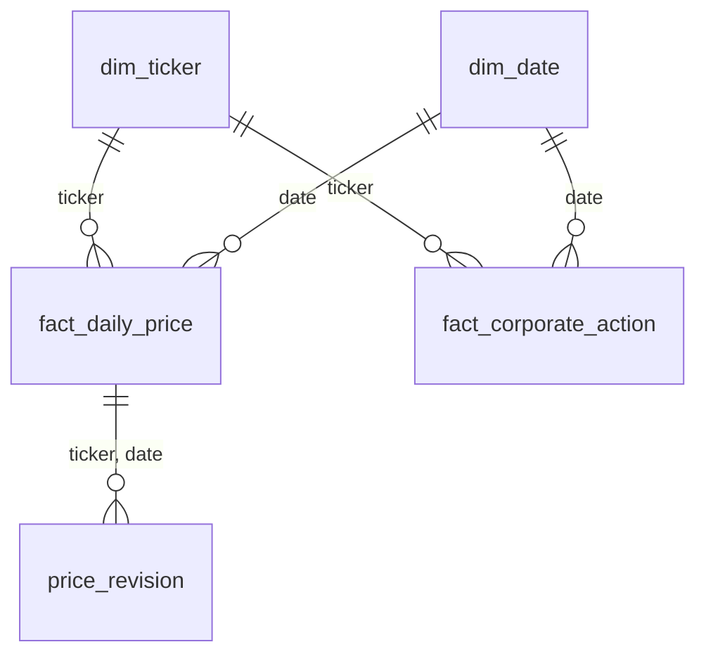

# MarketPulse

A lakehouse pipeline for daily S&P 500 market data, built on Databricks (Free Edition)
with PySpark and Delta Lake.

- **Sources:** Yahoo Finance via `yfinance` (daily OHLCV, adjusted close, dividends, splits,
  company profiles) and Wikipedia's S&P 500 constituents table (GICS sector, sub-industry,
  date added).
- **Scale:** ~503 tickers × 10 years ≈ 1.2M daily price rows (~367 MB raw JSON per full load,
  ~8 MB per daily incremental batch).

## Architecture

```
 LAPTOP (internet access)                       DATABRICKS FREE EDITION (PySpark + Delta)
 extract/ingest.py ──► data/landing/<batch_id>/
 extract/upload.py ─────────── upload ────────► /Volumes/workspace/raw/landing/<batch_id>/
                                                        │  01_raw_to_bronze
                                                        ▼
                                                 workspace.bronze.*   raw values, explicit STRING schemas
                                                        │  02_bronze_to_silver
                                                        ▼
                                                 workspace.silver.*   typed, MERGEd on natural keys
                                                 workspace.ops.pipeline_execution_logs
```

Extraction runs outside Databricks because Free Edition serverless compute cannot resolve
external hosts (`yfinance` fails with `Could not resolve host: query2.finance.yahoo.com`).
The extractor lands each run as a self-contained batch folder; everything from the raw
landing zone onwards runs in Spark.

## Repository layout

```
extract/            local Source -> Raw extraction and upload to the raw Volume
src/marketpulse/    pipeline modules (schemas, audit logging, drift handling, layer logic)
notebooks/          thin Databricks notebooks that read parameters and call src/marketpulse
data/landing/       local raw batches (git-ignored; each member extracts their own)
```

## Raw landing batch format

```
data/landing/<batch_id>/              batch_id = <UTC stamp>_<mode>, e.g. 20261010T132844Z_full
    sp500_constituents.json           Wikipedia S&P 500 table
    prices/<TICKER>.json              daily OHLC, Adj Close, Volume, Dividends, Stock Splits
    company_info/<TICKER>.json        yfinance Ticker.info payload
    manifest.json                     written last; a batch without it is incomplete
```

## Data models

Every table lives in Unity Catalog as `<catalog>.<schema>.<table>`; the catalog is a pipeline
parameter and defaults to `workspace`. The column-level tables below are generated from
`src/marketpulse/schemas.py` by `scripts/generate_data_dictionary.py`, so they always match what
the pipeline creates.

### Layer conventions

| Layer | Location | Holds | Types | Keys |
|---|---|---|---|---|
| Raw | `/Volumes/<catalog>/raw/landing/<batch_id>/` | JSON files exactly as extracted, one folder per batch | as in the source | none |
| Bronze | `<catalog>.bronze.*` | One row per source record per batch | every source value is `STRING` | grain documented, not enforced |
| Silver | `<catalog>.silver.*` | Cleaned, typed, deduplicated tables, MERGEd on natural keys | real types (`DATE`, `DOUBLE`, `BIGINT`, ...) | enforced: `NOT NULL` + `PRIMARY KEY` |

- **Schema-on-read.** Every raw file is read with an explicit `StructType`; Spark schema inference is never used.
- **Bronze values are strings.** A type change at the source (for example `Volume` arriving as `"1.2M"`) can never fail a bronze load. Values are converted with `try_cast` on the way to silver, and rows that fail land in a `quarantine_*` table with a `reject_reason`.
- **Keys are enforced from silver onwards.** Bronze must accept whatever arrived, including malformed rows, so its keys describe the grain only.
- **Lineage.** Every bronze row carries `batch_id`, `source_file` and `load_timestamp`. Every silver row carries `load_timestamp` and, except `dim_date`, the `batch_id` that last wrote it.
- **Schema drift.** Bronze `prices` and `constituents` have a `_rescued_data` column that captures any field the schema does not know. `company_info` deliberately has none: Yahoo returns about 190 profile fields and MarketPulse keeps 18, so the ignored fields would fill it on every row and it would never signal real drift.

### Relationships



- `fact_daily_price` and `fact_corporate_action` join to `dim_ticker` on `ticker` and to `dim_date` on `date`.
- `price_revision` records every change the silver MERGE applied to a `fact_daily_price` row, keyed by the batch that caused it.
- `quarantine_prices` and `quarantine_company_info` hold bronze rows rejected on the way to silver, with the bronze columns plus `reject_reason`.

<!-- data-dictionary:start -->

### Raw → bronze column mapping

Raw JSON field names are renamed to snake_case in bronze (Delta column names cannot contain spaces).

**prices/<TICKER>.json**

| Raw JSON field | Bronze column |
|---|---|
| `Ticker` | `ticker` |
| `Date` | `date` |
| `Open` | `open` |
| `High` | `high` |
| `Low` | `low` |
| `Close` | `close` |
| `Adj Close` | `adj_close` |
| `Volume` | `volume` |
| `Dividends` | `dividends` |
| `Stock Splits` | `stock_splits` |

**sp500_constituents.json**

| Raw JSON field | Bronze column |
|---|---|
| `Symbol` | `symbol` |
| `Security` | `security` |
| `GICS Sector` | `gics_sector` |
| `GICS Sub-Industry` | `gics_sub_industry` |
| `Headquarters Location` | `headquarters_location` |
| `Date added` | `date_added` |
| `CIK` | `cik` |
| `Founded` | `founded` |

**company_info/<TICKER>.json**

| Raw JSON field | Bronze column |
|---|---|
| `_ticker` | `ticker` |
| `_fetched_at` | `fetched_at` |
| `longName` | `long_name` |
| `sector` | `sector` |
| `industry` | `industry` |
| `fullExchangeName` | `full_exchange_name` |
| `currency` | `currency` |
| `country` | `country` |
| `marketCap` | `market_cap` |
| `sharesOutstanding` | `shares_outstanding` |
| `beta` | `beta` |
| `trailingPE` | `trailing_pe` |
| `forwardPE` | `forward_pe` |
| `dividendYield` | `dividend_yield` |
| `payoutRatio` | `payout_ratio` |
| `fullTimeEmployees` | `full_time_employees` |
| `website` | `website` |
| `firstTradeDateMilliseconds` | `first_trade_date_ms` |

### Bronze tables

#### `bronze.prices`

Raw daily prices, dividends and splits per batch, all values as strings

**Grain:** `batch_id`, `ticker`, `date` (documented, not enforced)

| Column | Type | Nullable | Description |
|---|---|---|---|
| `ticker` | `string` | yes | Yahoo ticker symbol, e.g. BRK-B |
| `date` | `string` | yes | Trading day, YYYY-MM-DD |
| `open` | `string` | yes | Opening price |
| `high` | `string` | yes | Intraday high |
| `low` | `string` | yes | Intraday low |
| `close` | `string` | yes | Closing price (split-adjusted, not dividend-adjusted) |
| `adj_close` | `string` | yes | Close adjusted for splits and dividends; Yahoo revises it after each dividend |
| `volume` | `string` | yes | Shares traded |
| `dividends` | `string` | yes | Cash dividend per share going ex on this day, 0 if none |
| `stock_splits` | `string` | yes | Split ratio effective on this day (4.0 = 4-for-1), 0 if none |
| `_rescued_data` | `string` | yes | JSON of any source fields not in the schema; non-null means the source schema drifted |
| `batch_id` | `string` | yes | Landing batch this row came from, e.g. 20261010T132844Z_full |
| `source_file` | `string` | yes | Full path of the raw JSON file this row was read from |
| `load_timestamp` | `timestamp` | yes | When this row was written to this table |

#### `bronze.constituents`

Raw S&P 500 constituents table from Wikipedia per batch, all values as strings

**Grain:** `batch_id`, `symbol` (documented, not enforced)

| Column | Type | Nullable | Description |
|---|---|---|---|
| `symbol` | `string` | yes | Ticker as listed by Wikipedia (class shares use a dot, e.g. BRK.B) |
| `security` | `string` | yes | Company name |
| `gics_sector` | `string` | yes | GICS sector |
| `gics_sub_industry` | `string` | yes | GICS sub-industry |
| `headquarters_location` | `string` | yes | City and state or country of headquarters |
| `date_added` | `string` | yes | Date the company joined the S&P 500, YYYY-MM-DD |
| `cik` | `string` | yes | SEC Central Index Key |
| `founded` | `string` | yes | Founding year as written on Wikipedia, sometimes a range or note |
| `_rescued_data` | `string` | yes | JSON of any source fields not in the schema; non-null means the source schema drifted |
| `batch_id` | `string` | yes | Landing batch this row came from, e.g. 20261010T132844Z_full |
| `source_file` | `string` | yes | Full path of the raw JSON file this row was read from |
| `load_timestamp` | `timestamp` | yes | When this row was written to this table |

#### `bronze.company_info`

Raw yfinance company profiles per batch (selected fields), all values as strings

**Grain:** `batch_id`, `ticker` (documented, not enforced)

| Column | Type | Nullable | Description |
|---|---|---|---|
| `ticker` | `string` | yes | Ticker the profile was requested for (added by extract/ingest.py) |
| `fetched_at` | `string` | yes | UTC ISO timestamp the profile was fetched (added by extract/ingest.py) |
| `long_name` | `string` | yes | Full company name |
| `sector` | `string` | yes | Yahoo sector |
| `industry` | `string` | yes | Yahoo industry |
| `full_exchange_name` | `string` | yes | Listing exchange, e.g. NasdaqGS |
| `currency` | `string` | yes | Trading currency |
| `country` | `string` | yes | Country of headquarters |
| `market_cap` | `string` | yes | Market capitalisation at fetch time |
| `shares_outstanding` | `string` | yes | Shares outstanding |
| `beta` | `string` | yes | Beta versus the market |
| `trailing_pe` | `string` | yes | Trailing twelve-month price/earnings |
| `forward_pe` | `string` | yes | Forward price/earnings |
| `dividend_yield` | `string` | yes | Dividend yield as reported by Yahoo |
| `payout_ratio` | `string` | yes | Share of earnings paid as dividends |
| `full_time_employees` | `string` | yes | Full-time employees |
| `website` | `string` | yes | Company website |
| `first_trade_date_ms` | `string` | yes | First trading day as epoch milliseconds |
| `batch_id` | `string` | yes | Landing batch this row came from, e.g. 20261010T132844Z_full |
| `source_file` | `string` | yes | Full path of the raw JSON file this row was read from |
| `load_timestamp` | `timestamp` | yes | When this row was written to this table |

### Silver tables

#### `silver.fact_daily_price`

One row per ticker per trading day, MERGEd so upstream revisions update in place

**Primary key:** `ticker`, `date` (enforced: `NOT NULL` + `PRIMARY KEY` constraint)

| Column | Type | Nullable | Description |
|---|---|---|---|
| `ticker` | `string` | no | Yahoo ticker symbol |
| `date` | `date` | no | Trading day |
| `open` | `double` | yes | Opening price |
| `high` | `double` | yes | Intraday high |
| `low` | `double` | yes | Intraday low |
| `close` | `double` | yes | Closing price (split-adjusted) |
| `adj_close` | `double` | yes | Close adjusted for splits and dividends (latest Yahoo revision) |
| `volume` | `bigint` | yes | Shares traded |
| `batch_id` | `string` | yes | Landing batch this row came from, e.g. 20261010T132844Z_full |
| `load_timestamp` | `timestamp` | yes | When this row was written to this table |

#### `silver.fact_corporate_action`

Dividends and stock splits, one row per ticker, date and action type

**Primary key:** `ticker`, `date`, `action_type` (enforced: `NOT NULL` + `PRIMARY KEY` constraint)

| Column | Type | Nullable | Description |
|---|---|---|---|
| `ticker` | `string` | no | Yahoo ticker symbol |
| `date` | `date` | no | Ex-date of the dividend or effective date of the split |
| `action_type` | `string` | no | dividend or split |
| `value` | `double` | yes | Cash per share for a dividend, ratio for a split (4.0 = 4-for-1) |
| `batch_id` | `string` | yes | Landing batch this row came from, e.g. 20261010T132844Z_full |
| `load_timestamp` | `timestamp` | yes | When this row was written to this table |

#### `silver.dim_ticker`

One row per company: Wikipedia constituents joined with Yahoo company profiles

**Primary key:** `ticker` (enforced: `NOT NULL` + `PRIMARY KEY` constraint)

| Column | Type | Nullable | Description |
|---|---|---|---|
| `ticker` | `string` | no | Yahoo ticker symbol |
| `company_name` | `string` | yes | Company name (Yahoo long name, else Wikipedia) |
| `gics_sector` | `string` | yes | GICS sector (Wikipedia) |
| `gics_sub_industry` | `string` | yes | GICS sub-industry (Wikipedia) |
| `yf_sector` | `string` | yes | Sector as classified by Yahoo |
| `yf_industry` | `string` | yes | Industry as classified by Yahoo |
| `exchange` | `string` | yes | Listing exchange |
| `currency` | `string` | yes | Trading currency |
| `country` | `string` | yes | Country of headquarters |
| `headquarters` | `string` | yes | Headquarters location (Wikipedia) |
| `sp500_date_added` | `date` | yes | Date added to the S&P 500 |
| `cik` | `bigint` | yes | SEC Central Index Key |
| `founded` | `string` | yes | Founding year as written on Wikipedia |
| `market_cap` | `bigint` | yes | Market capitalisation at info_as_of |
| `shares_outstanding` | `bigint` | yes | Shares outstanding at info_as_of |
| `beta` | `double` | yes | Beta versus the market |
| `trailing_pe` | `double` | yes | Trailing price/earnings |
| `forward_pe` | `double` | yes | Forward price/earnings |
| `dividend_yield` | `double` | yes | Dividend yield as reported by Yahoo |
| `payout_ratio` | `double` | yes | Share of earnings paid as dividends |
| `full_time_employees` | `bigint` | yes | Full-time employees |
| `website` | `string` | yes | Company website |
| `first_trade_date` | `date` | yes | First trading day on Yahoo |
| `info_as_of` | `timestamp` | yes | When the Yahoo profile fields were fetched |
| `is_sp500_member` | `boolean` | yes | In the most recently loaded S&P 500 constituents list |
| `batch_id` | `string` | yes | Landing batch this row came from, e.g. 20261010T132844Z_full |
| `load_timestamp` | `timestamp` | yes | When this row was written to this table |

#### `silver.dim_date`

Calendar dimension covering the full price history

**Primary key:** `date_key` (enforced: `NOT NULL` + `PRIMARY KEY` constraint)

| Column | Type | Nullable | Description |
|---|---|---|---|
| `date_key` | `int` | no | Date as yyyymmdd integer |
| `date` | `date` | yes | Calendar date |
| `year` | `int` | yes | Calendar year |
| `quarter` | `int` | yes | Quarter 1-4 |
| `month` | `int` | yes | Month 1-12 |
| `month_name` | `string` | yes | Month name, e.g. January |
| `iso_week` | `int` | yes | ISO week of year |
| `day_of_week` | `int` | yes | ISO day of week, 1 = Monday |
| `day_name` | `string` | yes | Day name, e.g. Monday |
| `is_weekend` | `boolean` | yes | Saturday or Sunday |
| `is_trading_day` | `boolean` | yes | At least one price exists for this date |
| `is_month_end` | `boolean` | yes | Last calendar day of the month |
| `load_timestamp` | `timestamp` | yes | When this row was written to this table |

#### `silver.price_revision`

Audit of every upstream price change caught by the fact_daily_price MERGE

**Primary key:** `ticker`, `date`, `batch_id` (enforced: `NOT NULL` + `PRIMARY KEY` constraint)

| Column | Type | Nullable | Description |
|---|---|---|---|
| `ticker` | `string` | no | Yahoo ticker symbol |
| `date` | `date` | no | Trading day whose values changed |
| `old_close` | `double` | yes | Close before the revision |
| `new_close` | `double` | yes | Close after the revision |
| `old_adj_close` | `double` | yes | Adjusted close before the revision |
| `new_adj_close` | `double` | yes | Adjusted close after the revision |
| `adj_close_pct` | `double` | yes | Relative change in adjusted close, new / old - 1 |
| `old_volume` | `bigint` | yes | Volume before the revision |
| `new_volume` | `bigint` | yes | Volume after the revision |
| `previous_batch_id` | `string` | yes | Batch that wrote the old values |
| `batch_id` | `string` | no | Batch whose MERGE detected the change |
| `load_timestamp` | `timestamp` | yes | When this row was written to this table |

#### `silver.quarantine_prices`

Bronze price rows rejected on the way to silver, with the reason

**Grain:** `batch_id`, `ticker`, `date` (documented, not enforced)

| Column | Type | Nullable | Description |
|---|---|---|---|
| `ticker` | `string` | yes | Yahoo ticker symbol, e.g. BRK-B |
| `date` | `string` | yes | Trading day, YYYY-MM-DD |
| `open` | `string` | yes | Opening price |
| `high` | `string` | yes | Intraday high |
| `low` | `string` | yes | Intraday low |
| `close` | `string` | yes | Closing price (split-adjusted, not dividend-adjusted) |
| `adj_close` | `string` | yes | Close adjusted for splits and dividends; Yahoo revises it after each dividend |
| `volume` | `string` | yes | Shares traded |
| `dividends` | `string` | yes | Cash dividend per share going ex on this day, 0 if none |
| `stock_splits` | `string` | yes | Split ratio effective on this day (4.0 = 4-for-1), 0 if none |
| `_rescued_data` | `string` | yes | JSON of any source fields not in the schema; non-null means the source schema drifted |
| `batch_id` | `string` | yes | Landing batch this row came from, e.g. 20261010T132844Z_full |
| `source_file` | `string` | yes | Full path of the raw JSON file this row was read from |
| `load_timestamp` | `timestamp` | yes | When this row was written to this table |
| `reject_reason` | `string` | yes | Why the row failed validation or casting |

#### `silver.quarantine_company_info`

Bronze company profile rows rejected on the way to silver, with the reason

**Grain:** `batch_id`, `ticker` (documented, not enforced)

| Column | Type | Nullable | Description |
|---|---|---|---|
| `ticker` | `string` | yes | Ticker the profile was requested for (added by extract/ingest.py) |
| `fetched_at` | `string` | yes | UTC ISO timestamp the profile was fetched (added by extract/ingest.py) |
| `long_name` | `string` | yes | Full company name |
| `sector` | `string` | yes | Yahoo sector |
| `industry` | `string` | yes | Yahoo industry |
| `full_exchange_name` | `string` | yes | Listing exchange, e.g. NasdaqGS |
| `currency` | `string` | yes | Trading currency |
| `country` | `string` | yes | Country of headquarters |
| `market_cap` | `string` | yes | Market capitalisation at fetch time |
| `shares_outstanding` | `string` | yes | Shares outstanding |
| `beta` | `string` | yes | Beta versus the market |
| `trailing_pe` | `string` | yes | Trailing twelve-month price/earnings |
| `forward_pe` | `string` | yes | Forward price/earnings |
| `dividend_yield` | `string` | yes | Dividend yield as reported by Yahoo |
| `payout_ratio` | `string` | yes | Share of earnings paid as dividends |
| `full_time_employees` | `string` | yes | Full-time employees |
| `website` | `string` | yes | Company website |
| `first_trade_date_ms` | `string` | yes | First trading day as epoch milliseconds |
| `batch_id` | `string` | yes | Landing batch this row came from, e.g. 20261010T132844Z_full |
| `source_file` | `string` | yes | Full path of the raw JSON file this row was read from |
| `load_timestamp` | `timestamp` | yes | When this row was written to this table |
| `reject_reason` | `string` | yes | Why the row failed validation or casting |

### Operational tables

#### `ops.pipeline_execution_logs`

One row per pipeline step (batch × source → target table) across every layer.

**Primary key:** `log_id` (enforced)

| Column | Type | Nullable | Description |
|---|---|---|---|
| `log_id` | `string` | no | Unique id of this log entry (primary key) |
| `pipeline_run_id` | `string` | yes | Groups every entry written by one notebook or job run |
| `layer` | `string` | yes | source_to_raw \| raw_to_bronze \| bronze_to_silver |
| `load_type` | `string` | yes | full \| incremental \| backfill |
| `batch_id` | `string` | yes | Landing batch processed, e.g. 20261010T132844Z_full |
| `parameter` | `string` | yes | Exact input processed: a Volume path or the backfill parameters |
| `target_table` | `string` | yes | Fully qualified table (or Volume) written to |
| `start_time` | `timestamp` | yes | When the step started |
| `end_time` | `timestamp` | yes | When the step finished; null while RUNNING |
| `duration_seconds` | `double` | yes | end_time minus start_time |
| `status` | `string` | yes | RUNNING \| SUCCESS \| FAILED \| SKIPPED |
| `rows_read` | `bigint` | yes | Rows read from the source of this step |
| `rows_inserted` | `bigint` | yes | Rows inserted into the target |
| `rows_updated` | `bigint` | yes | Existing target rows updated |
| `rows_quarantined` | `bigint` | yes | Rows rejected to a quarantine table |
| `error_message` | `string` | yes | Exception (FAILED) or warning text |
| `executed_by` | `string` | yes | Databricks identity that ran the step |
| `load_timestamp` | `timestamp` | yes | When this log row was last written |

<!-- data-dictionary:end -->

## Execution guide

_To be completed: running a standard incremental load vs. a parameterized backfill._

### One-time setup

**Databricks**

1. Create a Git folder from this repository (Workspace → your user folder → Create → Git folder).
2. Open `notebooks/00_setup`, attach it to **Serverless** and run all. It creates the `raw`,
   `bronze`, `silver` and `ops` schemas and the `raw.landing` Volume. The `catalog` widget
   defaults to `workspace`.

**Laptop** (extraction and upload)

```bash
pip install -r requirements.txt
winget install Databricks.DatabricksCLI
databricks auth login --host https://<your-workspace>.cloud.databricks.com --profile marketpulse
```

`auth login` opens a browser to sign in and stores the `marketpulse` profile in
`~/.databrickscfg`; `extract/upload.py` uses it by default.

### Extract and upload a batch

```bash
python extract/ingest.py --mode full          # 10-year baseline for all S&P 500 tickers
python extract/ingest.py --mode incremental   # re-pull the last month (captures adj-close revisions)
python extract/upload.py                      # send every new local batch to the raw Volume
```

`upload.py --batch-id <id>` re-sends one specific batch; add `--overwrite` to replace a batch
that is already in the Volume.


