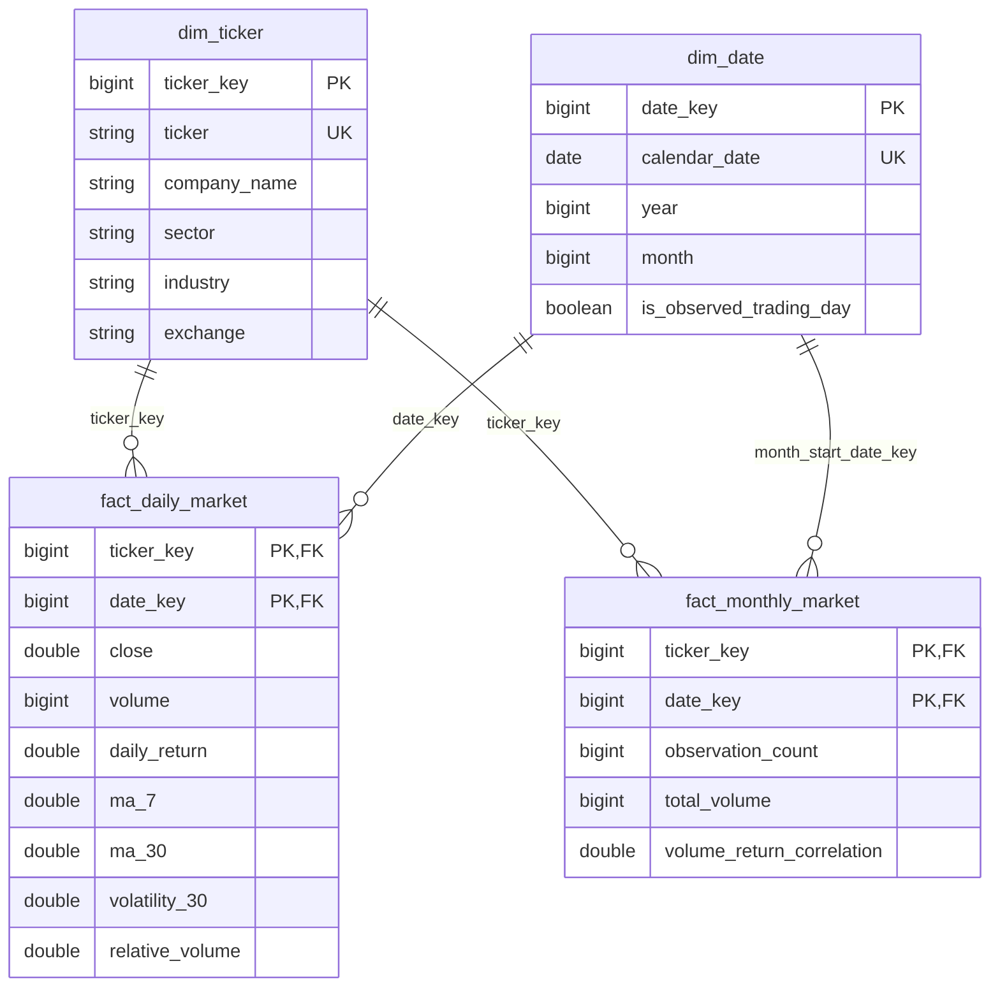

# Gold model and metric contract

Catalog defaults to `workspace`; Gold schema defaults to `gold`.
Column types/descriptions are generated into README from `schemas.py`.

## Grain and relationships

| Object | Grain | Key / relationship |
|---|---|---|
| dim_ticker | One allocated ticker | Numeric ticker_key PK; ticker must also be unique |
| dim_date | One calendar day | YYYYMMDD date_key PK; calendar_date unique |
| fact_daily_market | Ticker x observed trading day | Composite ticker_key/date_key PK; FKs to both dimensions |
| fact_monthly_market | Ticker x observed month | Composite ticker_key/date_key PK; date_key references first calendar day of month |
| vw_pipeline_execution | One execution step/attempt | log_id; optional execution-date relationship to dim_date |
| vw_data_quality | Batch x source table x combined reject reason | Aggregate directly over quarantine; leave disconnected from market date |
| vw_price_revisions | Ticker x revised trading date x detecting batch | FKs by logical relationship to Ticker and Date |

PK/FK declarations are informational in Databricks. NOT NULL is enforced. Gold
preflight/staging/publication checks explicitly reject duplicate/null keys and
orphan fact references. No RELY hint is set without independent evidence.

Ticker keys are allocated once using max(existing key) + row_number over unseen
symbols. Existing keys survive new symbols, missing profiles and retired symbols.
Run one writer at a time. Clearing the Gold dimension requires rebuilding facts
and refreshing the Power BI model together. Type 1 updates change descriptions in
place; historical facts use the latest sector classification, not an invented SCD2 history.

The Date dimension is contiguous from the first price/log month through the latest
date/current UTC day. Weekends exist in Date but have no fabricated price rows.
Observed trading day means at least one ticker has data; it is not an exchange calendar.

## Measures (fractions, not pre-multiplied percentages)

| Field | Definition | Completeness |
|---|---|---|
| daily_return | adj_close(t) / adj_close(previous observed row) - 1 | Both adjacent prices positive and finite |
| abs_daily_return | abs(daily_return) | Null when return unknown |
| ma_7 / ma_30 | Arithmetic mean of CLOSE over last 7/30 observations, current included | Exactly 7/30 valid positive closes required |
| volatility_30 | Sample standard deviation of daily_return over last 30 observations | 30 valid returns required: earliest result is observation 31 |
| annualized_volatility_30 | volatility_30 x sqrt(252) | Assumes 252 observations/year; descriptive convention |
| avg_volume_prior_30 | Mean volume of preceding 30 observations, excluding current | 30 valid non-negative volumes required |
| relative_volume | Current volume / avg_volume_prior_30 | Null when baseline zero/incomplete |
| monthly correlations | Pearson correlation of raw/relative volume with absolute return, per ticker-month | Pairwise complete; null when either variable has zero variance |

"7-day/30-day" in the proposal means **trading observations**, not calendar-day
intervals. Windows are computed before dashboard filters. Non-trading gaps are
not filled with zero returns. Missing adjusted prices interrupt adjacent returns;
the following return does not jump over the missing row. Invalid analytical
prices become NULL, not a misleading zero. Silver remains the source of truth.

Volume and observation counts are additive. Close, moving averages, volatility,
relative volume and correlations must not be summed. Do not sum daily returns
to obtain period return. An average across stocks is not an official index return.
Monthly correlations are supplementary summaries; never average them to answer
an arbitrary selected-period correlation question.

## Refresh and lineage

Each run pins Silver price/profile Delta versions and records them in audit
parameters. Full-history recalculation propagates newly inserted/backfilled rows
and corrections through all subsequent windows. It uses conditional MERGE so
unchanged rows preserve load_timestamp. Source batch_id is retained on daily facts.
Monthly rows summarize many batches and intentionally have no fictitious single batch_id.
Monthly logs report rows_read = daily source observations and rows_aggregated =
output ticker-month groups. Delta counts report actual inserts/updates/deletes.

Staged Delta tables materialize calculations once and are removed after each run.
No Gold table is dropped/recreated during ordinary refresh. Fact reconciliation
deletes keys absent from the pinned source; dimensional keys are retained.
All layers share a run id. Upstream failures stop publication. Retry recomputes
Gold even if Bronze/Silver already completed. Multiple tables are not one atomic
transaction: Power BI Import refresh is allowed only after the complete job succeeds.

The daily source lookback is one month, so Gold cannot repair upstream changes
that never reach Silver. Use an occasional longer extraction (`--period 10y`)
when reconciling older Yahoo adjustments. The present universe is current S&P
constituents, so long-run comparisons have survivorship bias. Company financial
profiles are current snapshots; Gold does not claim historical valuation data.
